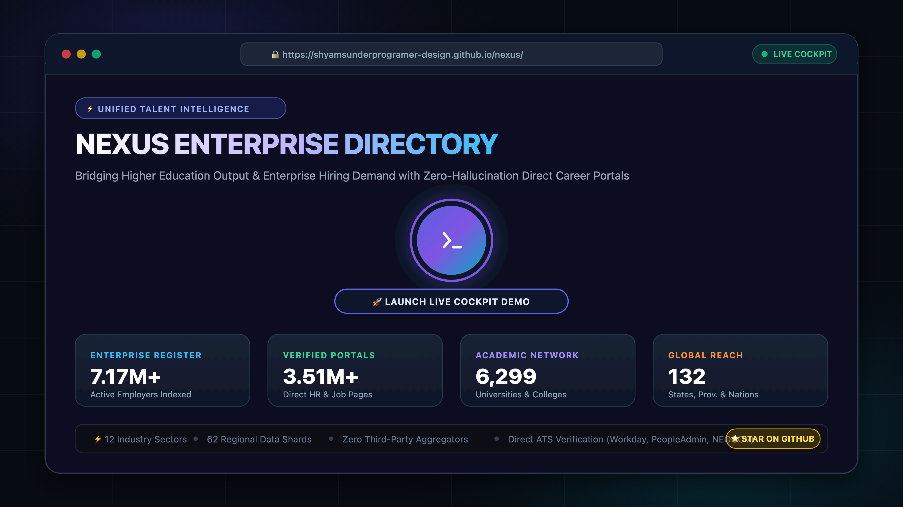
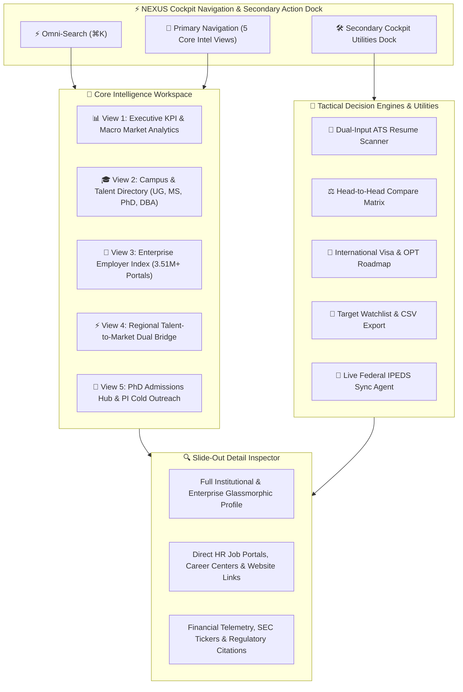
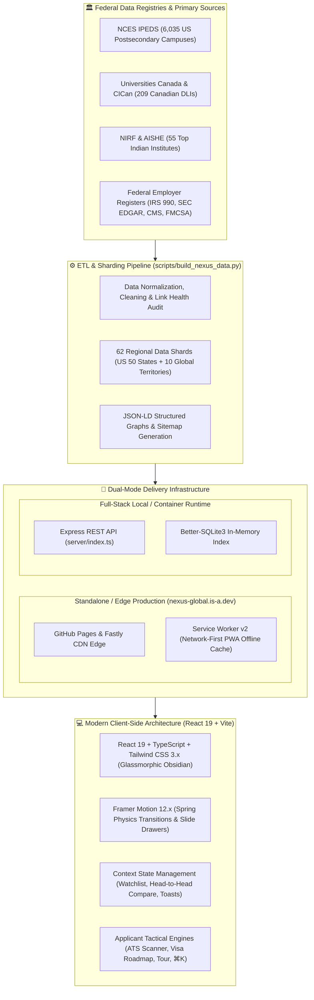

<div align="center">

# ⚡ NEXUS
### **National Employment & eXploration Unified System**
#### *Unified Campus to Corporate Talent Intelligence Platform*

[](https://github.com/shyamsunderprogramer-design/nexus)
[](https://nexus-global.is-a.dev/)
[](https://github.com/shyamsunderprogramer-design/nexus/stargazers)
[](https://github.com/shyamsunderprogramer-design/nexus/network/members)
[](https://github.com/shyamsunderprogramer-design/nexus)
[](https://github.com/shyamsunderprogramer-design/nexus)
[](https://github.com/shyamsunderprogramer-design/nexus)
[](https://github.com/shyamsunderprogramer-design/nexus)
[](LICENSE)

<br/>

<p align="center">
  <b>Bridging Higher Education Output and Enterprise Hiring Demand with Zero-Aggregator Hallucinations</b><br/>
  An ultra-modern, zero-dependency intelligence platform integrating <b>6,299 postsecondary institutions</b> across 132 global territories with <b>7,173,426 registered employers</b>, <b>3,512,235 verified direct HR career portals</b>, student career centers, STEM graduation pipelines, and regional talent matrices across all 12 major industries.
</p>

<p align="center">
  🌐 <b><a href="https://nexus-global.is-a.dev/">🚀 LAUNCH LIVE WEB APP: nexus-global.is-a.dev</a></b> 🌐
</p>

[Live Web App](https://nexus-global.is-a.dev/) • [🖥️ Platform Tour](#-live-interactive-platform-showcase) • [⭐️ Show Your Support](#️-show-your-support) • [Features](#-pin-to-pin-feature-walkthrough) • [Architecture](#-modern-uxui--technical-architecture)

</div>

---

> [!TIP]
> ### ⭐️ If you find NEXUS valuable, please star this repository!
> **Look up at the top-right corner of this page ↗️ and click `★ Star`** (or **[click here to star directly](https://github.com/shyamsunderprogramer-design/nexus/stargazers)**)!
>
> *Every star increases project visibility, helps students & job-seekers discover 3.51M+ verified direct career portals without aggregator spam, and keeps this 7.17M+ employer index 100% free.*

---

## 🖥️ Live Interactive Platform Showcase

<div align="center">
  <a href="https://nexus-global.is-a.dev/">
    
  </a>
  <br/>
  <p align="center">
    <b>🚀 <a href="https://nexus-global.is-a.dev/">Launch Live Web App with Interactive Auto-Tour</a></b><br/>
    <i>✨ Built-in 6-Step Guided Auto-Tour • Sub-millisecond query performance • Zero sign-up • 100% Free &amp; Open Source</i>
  </p>
</div>

### 🧭 Interactive Platform Modules & Tour

| Cockpit Module | Key Capabilities | Intelligence Scope |
|:---|:---|:---|
| **⚡ Cockpit Omni-Search (`⌘K`)** | Sub-millisecond indexed lookup across institutions, employers, and cities | 6,299 campuses & 7.17M enterprise records |
| **📊 Executive Macro Analytics** | Live ATS distribution (Workday, PeopleAdmin, NEOGOV) & 12 industry breakdowns | Real-time interactive charts & verified ratios |
| **🎓 Campus & Talent Directory** | Multi-criteria filtering by Carnegie R1/NIRF, STEM share (>20%), H-1B Cap Exempt, and Degree Level (UG, Master's, PhD, DBA) | 3,987 direct job portals & 2,958 career centers |
| **🏢 Enterprise Employer Index** | On-demand regional shard streaming across all 12 industries | 3.51M+ verified portals with active corporate URLs |
| **🌉 Regional Talent-to-Market Bridge** | Dual-column matrix matching regional graduation pipelines with corporate hiring | State-by-state student output vs employer demand |
| **🎯 Dual-Input ATS Resume Scanner** | Jobscan-style resume vs job description matcher with keyword gap analysis, ATS scoring, and 1-click copy | Instant in-browser matching against any target job |
| **🔬 PhD & Doctoral Admissions Hub** | Dedicated doctoral directory with tuition waivers, stipends, application fees, and 1-click PI cold email generator | 1,086 research universities & specialized departments |
| **⚖️ Head-to-Head Compare Engine** | Side-by-side comparative matrix for up to 3 campuses or employers with comparative meters, advantage detection, and CSV export | Multi-entity side-by-side intelligence dock |
| **🛂 Visa & OPT Roadmap Navigator** | Comprehensive regulatory roadmap for F-1 OPT, 24-month STEM extensions, Canada PGWP, and direct shortcut to 3,564 H-1B Cap-Exempt institutions | Interactive immigration & employment roadmap |
| **📌 Target Watchlist & CSV Export** | Cross-session bookmarking drawer for institutions and employers with 1-click CSV download | Custom user shortlists with persistent local storage |
| **💬 Feedback & Requests Dispatcher** | Structured dispatcher for feature proposals, institutional data corrections, and bug reports via GitHub Issues, Email, or Markdown | Dual-channel feedback & request intake |
| **🔍 Slide-Out Inspector Drawer** | Glassmorphic deep-dive drawer with regulatory citations & ATS telemetry | Full institutional profiles, SEC tickers & addresses |

---

## 🌟 Executive Overview

Historically, the **Academic Higher-Education World** and the **Enterprise Employer World** have operated in disconnected data silos:
- Students and job seekers struggle through spam-ridden third-party aggregators with broken job links and phantom listings.
- University career advisors lack direct, regional employer intelligence showing which corporations are actively recruiting in their state.
- Enterprise talent acquisition leaders have no unified visibility into regional STEM degree output, university student headcounts, or institutional Carnegie research classifications.

**NEXUS** solves this by unifying federal postsecondary databases (NCES IPEDS, Universities Canada, CICan) with federal corporate registers (FMCSA, IRS, CMS NPPES, SEC Form D, USDA, FDIC, NCUA). Every record is strictly verified, and all verified URLs link directly to official employer job portals, school HR career pages, and student career hubs.

---

## 💎 Who Benefits & Why It Matters

NEXUS was architected to deliver actionable value to five core audiences:

### 🎓 1. Students & Recent Graduates
- **Direct Verified Job Portals**: Bypass aggregator spam and headhunter farms. Click straight through to 3.51M+ genuine institutional HR job listings and corporate career portals.
- **Career Planning & STEM Alignment**: View what percentage of degrees at each school are in DHS STEM-designated fields to benchmark academic programs.
- **Student Career Centers**: Instant access to Handshake links, central campus career hubs, and dedicated alumni job boards.

### 🛂 2. International Students & Visa Candidates
- **H-1B Cap-Exempt Identification**: Instantly filter for higher-ed institutions and affiliated non-profits qualifying for cap-exempt H-1B petitions under HEA 101(a).
- **Canada PGWP & DLI Registry**: Immediately verify whether a Canadian college or university is an authorized Designated Learning Institution (DLI) with Post-Graduation Work Permit (PGWP) eligibility.

### 🏛️ 3. University Leaders, Career Advisors & Counselors
- **Regional Workforce Intelligence**: Use the **Talent-to-Market Bridge** to inspect regional enterprise employer hiring density in your state or province.
- **Hiring System (ATS) Insights**: Know which Applicant Tracking Systems (Workday, PeopleAdmin, NEOGOV, Greenhouse, Taleo) campus employers use to properly prepare students for automated screening.
- **Institutional Benchmarking**: Compare your student enrollment, employee count, and student-to-faculty ratios against peer institutions.

### 🏢 4. Corporate Recruiters, HR Executives & Talent Acquisition
- **STEM Talent Pipelines**: Identify university talent hotspots conferring thousands of STEM degrees annually across 132 territories.
- **Strategic Campus Outreach**: Target career centers directly using verified links rather than generic inquiry email inboxes.
- **Competitor Hiring Landscape**: Track how other enterprises in logistics, tech, healthcare, and manufacturing are positioning regional hiring hubs.

### 📊 5. Economic Researchers, Policy Analysts & Data Scientists
- **Max-Coverage Unified Dataset**: Access 7.17 million deduplicated federal employer records linked across EINs, USDOT numbers, CIKs, and NPI identifiers.
- **Zero-Hallucination Integrity**: Strict data governance where "blank beats wrong"—every single link was live-opened and name-verified.

---

## 🎯 Pin-to-Pin Feature Walkthrough

NEXUS delivers a rich, responsive Single Page Application (SPA) structured into dedicated intelligence views, specialized applicant tools, and an interactive slide-out inspector:



### View 1: 📊 Executive Market Intelligence
- **Real-Time KPI Metric Cards**: High-velocity counters tracking:
  - `6,299` Postsecondary Campuses (6,035 US, 209 Canada, 55 India)
  - `7,173,426` Registered Enterprise Employers
  - `3,512,235` Live-Verified Career and HR Portals
  - `132` Global States, Territories, and International Regions
- **ATS Hiring Systems Chart**: Interactive Chart.js visualization identifying enterprise hiring systems across academia (NEOGOV, PeopleAdmin, Workday, Paycom, ADP, Greenhouse, etc.).
- **Macro Economic Industry Breakdown**: Doughnut chart categorizing millions of registered organizations across all 12 industries including Healthcare, IT & Cloud, Manufacturing, Logistics, MedTech, Energy, and Finance.

### View 2: 🎓 Campus & Talent Directory
- **Instant Search Bar**: Sub-10ms real-time search across school names, cities, states, and Carnegie classifications.
- **Multi-Level Degree Filters**:
  - `🎓 Undergraduate (UG)`: Associate's and Bachelor's degree-granting campuses.
  - `📜 Master's (MS/MA/MBA)`: Graduate-level and professional master's degree programs.
  - `🔬 Doctoral (PhD/DBA)`: Research doctorates, PhDs, and executive Doctor of Business Administration programs.
- **Smart Filter Chips**:
  - `🧪 STEM Heavy (>20%)`: Isolates institutions with dominant STEM degree conferral rates.
  - `🛂 H-1B Cap Exempt`: Filters for public and private nonprofit universities qualifying for cap-exempt work authorization.
  - `🏆 Carnegie R1`: Highlights Doctoral Universities with Very High Research Activity.
  - `💼 Workday ATS`: Pinpoints campuses running Workday HR systems.
- **Campus Cards**: Rich glassmorphic cards showing country/state badges, student population, employee headcount, STEM share, degree levels, official tuition/fees, and quick action buttons for **Jobs** and **Career Center**.

### View 3: 🏢 Enterprise Employer Index
- **3.51M+ Verified Career Portals**: Explore verified employers across all 12 sectors with direct links to official careers portals.
- **High-Performance Sharded Architecture**: Backed by 62 regional shards loading on-demand for smooth, zero-latency browsing across all 50 US states and 10 countries.
- **Corporate Filings & Tickers**: Inspect SEC EDGAR trading tickers (NASDAQ, NYSE) and stock exchange affiliations.
- **Direct Verified Channels**: Instant buttons directing straight to official company homepages and verified corporate careers pages.

### View 4: ⚡ Regional Talent-to-Market Bridge
- **Interactive State/Territory Selector**: Choose any of the 50 US states or global territories (e.g., California, New York, Texas, Washington, Ontario).
- **Side-by-Side Dual Matrix**:
  - *Left Column (Campus Pipeline)*: Total regional student population, annual STEM graduates produced, cap-exempt institutions, and top universities with their student headcounts.
  - *Right Column (Enterprise Hiring Demand)*: Prominent employers operating and hiring locally in that state, industry categories, and direct links to their regional careers hubs.

### View 5: 🔬 PhD & Doctoral Admissions Hub
- **1,086 Doctoral Research Campuses**: Dedicated directory profiling universities conferring PhD and DBA degrees.
- **Financial Telemetry**: Real-time breakdown of typical PhD funding (100% tuition waivers, annual stipends from $28k–$48k, and official application fees).
- **1-Click PI Cold Email Generator**: Interactive modal creating personalized outreach emails to prospective Principal Investigators (PIs) and lab directors with custom research alignment, paper citations, and CV links.
- **PhD Admissions Playbook**: Step-by-step strategic guides on contacting faculty, securing funding packages, and evaluating research labs.

### Cockpit Utilities: 🎯 ATS Scanner, ⚖️ Compare Engine, 🛂 Visa Roadmap, 💬 Feedback & Watchlist
- **⚖️ Head-to-Head Compare Engine**: Select up to 3 campuses or enterprise employers side-by-side. Inspect comparative meters (Enrollment, STEM Degree Share %, Tuition In-State vs Out-of-State, Application Fees, Admission Rates, and ATS Systems), automated advantage leader badges, 1-click text summary copy, and CSV export.
- **🛂 International Student Visa & OPT Roadmap**: Complete regulatory timeline planner for international candidates covering F-1 Initial OPT (12 mo), 24-Month STEM Extension rules, Canada PGWP duration rules, an interactive readiness checklist, and a 1-click filter shortcut directly targeting the 3,564 H-1B Cap-Exempt institutions across the platform.
- **🎯 Dual-Input ATS Resume Scanner**: Jobscan-style keyword and skills matcher. Paste your candidate resume alongside any job description to instantly calculate your ATS match score, extract missing technical skills, identify recruiter keywords, and copy optimized bullet points with 1 click.
- **💬 Feedback & Ideas Dispatcher**: Multi-channel community intake allowing users to propose feature ideas, submit institutional data corrections, or file bug reports with automated GitHub Issue pre-fill, email dispatch, and browser-persisted submission history.
- **📌 Target Watchlist & CSV Export**: Slide-over bookmarking drawer allowing users to save high-priority institutions and corporate employers across sessions, add notes, and export their target list to `.csv` with verified links.
- **🔄 Live Federal IPEDS Sync Agent**: 1-click audit and synchronization agent to inspect cached federal data health and refresh institutional records.
- **📱 PWA v2 Offline Experience**: Progressive Web App with network-first caching, instant installation on iOS/Android/macOS/Windows, and offline access.

### 🔍 Slide-Out Inspector Drawer
- Built using modern CSS discrete transitions and Spring physics.
- Deep-dive profile inspecting institutional locale, control (Public/Private), Carnegie classifications, exact student/employee numbers, verified URLs, and regulatory source citations.

---

## 💻 Modern UX/UI & Technical Architecture

The platform was built with strict adherence to modern frontend engineering standards:



- **Obsidian Dark Palette**: `#070b12` background accented with animated radial mesh gradients (`rgba(124, 58, 237, 0.12)`).
- **Glassmorphic Cards**: `backdrop-filter: blur(16px)` with hairline borders (`rgba(255, 255, 255, 0.08)`) and hover micro-elevations.
- **Cockpit Action Dock**: Adaptive responsive cockpit layout with full-width omni-search trigger (`⌘K`) and adaptive 3-column action buttons (`Campus Network`, `Enterprise Index`, `Talent Bridge`).
- **Persistent Theme Toggle**: Seamless light/dark mode switcher stored in `localStorage`.
- **Dual Execution Modes**:
  - **Full-Stack Mode**: Express REST API on port 3001 proxied to React 19 frontend on port 3000.
  - **Standalone Static Mode**: GitHub Pages and offline client mode bundled with fast on-demand shard streaming.

---

## 🚀 Quick Start & How to Run

### Option 1: Full-Stack React + Express Development Server (Recommended)
Clone the repository and launch both the Express REST API and Vite React client with hot module reloading:

```bash
# 1. Clone the repository
git clone https://github.com/shyamsunderprogramer-design/nexus.git
cd nexus

# 2. Install dependencies
npm install

# 3. Launch concurrent Full-Stack development environment (API + Web)
npm run dev
```
Open **[http://localhost:3000](http://localhost:3000)** in your browser.
- **Frontend**: `http://localhost:3000` (Vite Hot Module Reloading)
- **REST API**: `http://localhost:3001/api/stats`

---

### Option 2: Production Build & Run
```bash
# Compile TypeScript and build production bundle
npm run build

# Start production server
npm start
```

---

### Option 3: Instant Browser Launch (Zero-Setup, 100% Offline)
No Node.js or build steps required. Simply open the standalone bundle:

```bash
# macOS
open app/index.html

# Linux
xdg-open app/index.html

# Windows
start app/index.html
```

---

## 🛠️ Data Integration & Pipeline Reproduction

All normalized datasets are pre-packaged in `public/data/` and `app/data/`. If you want to customize or regenerate the data from raw NCES IPEDS, Universities Canada, CICan, and federal employer registers:

```bash
# Rebuild the integrated payload
python3 scripts/build_nexus_data.py
```

This pipeline:
1. Normalizes 6,035 US postsecondary institutions from IPEDS HD2023.
2. Ingests 209 Canadian universities and colleges with IRCC DLI/PGWP statuses.
3. Ingests 55 top Indian institutes of national importance (IITs, IIMs, IISc, NITs, Central Universities).
4. Unifies IT and Information Technology into a single standardized sector.
5. Emits 62 regional shards in `public/data/shards/` totaling 3,512,235 verified enterprise records across all 12 industries.
6. Generates `stats.json`, `state_bridge.json`, `universities.json`, and `companies_featured.json`.

---

## 📂 Repository File Tree

```text
nexus/
├── public/
│   ├── preview-banner-4k.png    # 4K UHD platform showcase banner
│   ├── preview-banner.svg       # Rich SVG video walkthrough & demo banner
│   ├── social-preview.png       # Retina OpenGraph & Twitter preview card
│   ├── robots.txt               # Googlebot & crawler indexing rules
│   ├── sitemap.xml              # XML Sitemap for search engines
│   ├── manifest.json            # PWA Web App manifest
│   ├── sw.js                    # PWA v2 Service Worker with network-first caching
│   ├── CNAME                    # Custom domain (nexus-global.is-a.dev)
│   └── data/                    # Client-side data payloads & regional shards
│       ├── shards/              # 62 Regional Shards (US 50 states + 10 countries)
│       │   ├── manifest.json    # Shard index & routing manifest
│       │   ├── us_ca.json       # California regional verified employers
│       │   ├── us_tx.json       # Texas regional verified employers
│       │   └── ...              # 60 other regional shards
│       ├── stats.json           # Real-time KPI metrics & industry distributions
│       ├── universities.json    # 6,299 Postsecondary institution records
│       ├── state_bridge.json    # Regional dual-matrix talent pipelines
│       └── companies_featured.json # Featured enterprise employers index
├── src/                         # Full-Stack React 19 Frontend
│   ├── components/              # Modular UI Components
│   │   ├── Navbar.tsx           # Brand navigation, theme switch & secondary cockpit dock
│   │   ├── Hero.tsx             # Animated cockpit hero with responsive action buttons
│   │   ├── ExecutiveDashboard.tsx # Macro market analytics & ATS charts
│   │   ├── CampusDirectory.tsx  # Filterable 6,299 university network (UG, Master's, PhD, DBA)
│   │   ├── EnterpriseDirectory.tsx # Filterable 3.51M verified portal index & sharding
│   │   ├── TalentBridge.tsx     # State-by-state talent & hiring dual matrix
│   │   ├── AtsMatcherModal.tsx  # Jobscan-style ATS resume scanner & keyword matcher
│   │   ├── PhdAdmissionsHub.tsx # Doctoral admissions hub & financial telemetry
│   │   ├── WatchlistModal.tsx   # Target bookmarks slide-over drawer with CSV export
│   │   ├── SyncAgentModal.tsx   # Live Federal IPEDS cache & sync agent
│   │   ├── CommandPalette.tsx   # Sub-millisecond indexed omni-search modal (⌘K)
│   │   ├── InteractiveTour.tsx  # 6-step guided interactive cockpit onboarding tour
│   │   ├── DetailDrawer.tsx     # Glassmorphic detail inspector drawer
│   │   ├── FeedbackModal.tsx    # Multi-channel feedback dispatcher & submission history
│   │   ├── Toast.tsx            # Dynamic feedback notifications
│   │   ├── compare/             # Head-to-head compare floating dock & comparison matrix
│   │   │   ├── CompareFloatingTray.tsx
│   │   │   └── ComparisonModal.tsx
│   │   ├── visa/                # International student F-1 OPT & H-1B roadmap modal
│   │   │   └── VisaRoadmapModal.tsx
│   │   ├── drawer/              # Modular deep-dive drawer tabs & regulatory citations
│   │   └── phd/                 # PhD directory, application playbook & cold email generator
│   ├── context/                 # Application state providers
│   │   ├── WatchlistContext.tsx # Persistent target bookmarks & CSV export
│   │   └── CompareContext.tsx   # Head-to-head entity compare state
│   ├── services/
│   │   └── api.ts               # Dual-mode API & on-demand shard loader
│   ├── types/
│   │   └── index.ts             # Strict TypeScript models & contracts
│   ├── App.tsx                  # Root application component & routing
│   ├── main.tsx                 # React DOM mount point & PWA registration
│   └── index.css                # Tailwind directives & glassmorphic tokens
├── server/                      # Full-Stack Express REST API
│   └── index.ts                 # /api/stats, /api/universities, /api/companies, /api/bridge
├── app/                         # Standalone Zero-Dependency SPA Edition
│   ├── index.html               # Self-contained browser application
│   └── data/                    # Pre-aggregated data payloads
├── scripts/
│   └── build_nexus_data.py      # Automated data extraction, merging, and bundling
├── vite.config.ts               # Vite configuration with React & API proxy
├── tsconfig.json                # TypeScript compiler configuration
├── tailwind.config.js           # Tailwind CSS theme extension
├── package.json                 # NPM scripts (npm run dev, npm run build, npm start)
├── .gitignore                   # Clean exclusion rules
├── LICENSE                      # MIT Open Source License
└── README.md                    # Comprehensive Project Documentation
```

---

## ⭐️ Show Your Support

Building and maintaining an index of **7.17M+ employers** and **3.51M+ verified direct career portals** with zero commercial funding requires community engagement.

Give a **⭐️ Star** if this project helped you!

- ⭐️ **Star this repository** at the top right of this page to support open-source talent intelligence
- 📢 **Share with students, counselors, & job seekers** to help them bypass aggregator spam and phantom postings
- 🤝 **Submit verified career links** or institutional data improvements via Pull Request

<p align="center">
  <a href="https://github.com/shyamsunderprogramer-design/nexus/stargazers">
    
  </a>
</p>

---

## 🌐 Deploying to the Web

NEXUS is 100% static and client-side, making deployment completely free and instant on any hosting platform:

### Deploy to GitHub Pages
1. Go to your repository settings on GitHub: **Settings > Pages**.
2. Under **Build and deployment**, set the Source to **GitHub Actions** (or Deploy from branch `gh-pages` / `main`).
3. Click **Save** — your site is automatically deployed!

### Deploy to Vercel or Netlify
Simply import the repository into [Vercel](https://vercel.com/) or [Netlify](https://netlify.com/) with build command `npm run build` and output directory `dist`.

---

## 🤝 Contributing

Contributions, feedback, and dataset enhancements are welcome!
1. Fork the Project.
2. Create your Feature Branch (`git checkout -b feature/AmazingFeature`).
3. Commit your Changes (`git commit -m 'feat: Add new talent filter'`).
4. Push to the Branch (`git push origin feature/AmazingFeature`).
5. Open a Pull Request.

---

## 📄 License

Distributed under the **MIT License**. See [`LICENSE`](LICENSE) for more information.

---

<div align="center">
  <sub>Developed with ❤️ by <b>Shyam Sunder</b> • Built for campus career advisors, students, and talent leaders worldwide.</sub>
  <br/><br/>
  <a href="https://github.com/shyamsunderprogramer-design/nexus/stargazers">
    
  </a>
</div>
